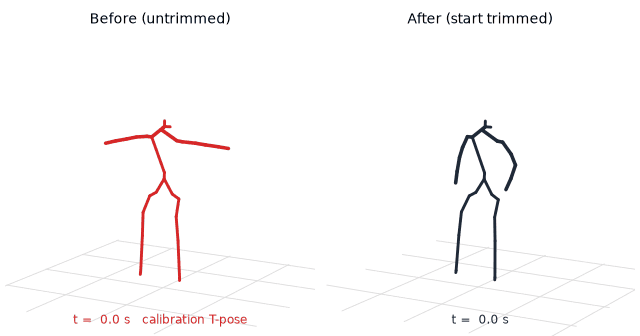

# BONES-SEED T-pose start trims

A manifest for trimming the opening calibration T-pose out of BONES-SEED motions.

In many BONES-SEED takes, the actor starts in a T-pose (arms straight out to the sides) and only then
begins the actual motion. Six actors (A001, A002, A005, A006, A008 and A417) do this in nearly every
standing clip. When these clips are retargeted and used as reference motion, the T-pose ends up heavily
overrepresented in the data, and downstream policies learn to drift into T-poses. This manifest lists
every clip that opens with such a segment and the frame range to keep so the segment is removed.



`walk_forward_confident_impro_001__A002` retargeted to the Unitree G1 (from
`dollhouserobotics/dollhouse-g1-bones-15hrs-basic`), first 7 seconds. Left: the untrimmed clip, which
holds a calibration T-pose (red) for 2.6 s before the walk starts. Right: the same clip trimmed with this
manifest, which starts with the walk.

## Files

| File | Contents |
|---|---|
| `bones_seed_tpose_trims.csv` | One row per trimmed clip, with the keep range in frames and seconds. |
| `bones_seed_tpose_trims.json` | The same clips with the detector parameters and per-clip detail (the detected hold and the 30 Hz keep range). |
| `scripts/` | The detection pipeline that produces both files; see [Reproducing the manifest](#reproducing-the-manifest). |
| `SHA256SUMS` | Checksums of the two manifest files. |

774 clips are listed: 387 originals and their `_M` mirrors. Together they lose 1,127.5 s (18.8 minutes).
Clips that are not listed have no opening T-pose to trim and should be used as they are.

### CSV columns

| Column | Meaning |
|---|---|
| `motion` | BONES-SEED clip name (the BVH file stem), such as `walk_forward_normal_001__A002`. Mirrors end in `_M`. |
| `bvh` | Path of the clip in the BONES-SEED repository. |
| `num_frames` | Frames in the source clip at 120 Hz. |
| `keep_start_frame`, `keep_end_frame` | Inclusive range of 120 Hz frames to keep. `keep_end_frame` is always the last frame. |
| `keep_start_s`, `keep_end_s` | The same range in seconds (frame / 120), rounded to 0.1 ms. The frame columns are authoritative. |
| `keep_start_frame_30hz` | First frame to keep in a 30 Hz resampling where 30 Hz frame `i` is 120 Hz frame `4i` (`ceil(keep_start_frame / 4)`). |

## Applying it

Drop every frame before `keep_start_frame` and keep the rest:

```python
import csv

trims = {r["motion"]: int(r["keep_start_frame"]) for r in csv.DictReader(open("bones_seed_tpose_trims.csv"))}

def trim(motion_name, frames_120hz):
    return frames_120hz[trims.get(motion_name, 0):]
```

For data already resampled to 30 Hz with frame `i` = 120 Hz frame `4i`, slice from
`keep_start_frame_30hz` instead. Velocity-like quantities that look forward in time stay valid after a
start cut, so nothing else needs recomputing. Events or labels timed from the clip start shift earlier by
`keep_start_s`.

## Source

Detected on the SOMA Uniform BVH of
[`bones-studio/seed`](https://huggingface.co/datasets/bones-studio/seed) at revision
`2f59b2077b9da34dd4e43618e705c7cb962c9a66`, all 142,220 clips, at 120 Hz.

## How the segments were found

- **T-pose:** both arms point within about 32 degrees of the outward shoulder line. The detector requires
  this at the very first frame.
- **Hold:** the pose is held for at least 0.1 s with the actor standing (hips above 0.7 m) and still
  (hips within 0.2 m of where they started).
- **Cut:** the arms must then come down below 60 degrees within 2 s, and the cut is placed where that
  descent ends. Everything from that frame on is kept.
- **Relaxed rule:** two clip pairs (`walk_forward_grab_injured_L_leg_003` for A005 and A417) drifted
  during the hold or held a looser T. They were cut under the relaxed rule in `params.relaxed` of the JSON,
  and the cut was checked by eye.
- **Mirrors:** each original and its mirror share one cut, so pairs stay the same length.

After retargeting, the cuts were also checked in robot space: no trimmed clip in the datasets below still
starts in a T-pose.

## Reproducing the manifest

The scripts in `scripts/` rebuild both manifest files byte for byte from the BONES-SEED source:

```bash
pip install -r requirements.txt
scripts/reproduce.sh work    # needs an HF token with access to bones-studio/seed
```

`reproduce.sh` runs these steps and ends by checking the outputs against `SHA256SUMS`:

| Step | Script | Output |
|---|---|---|
| Download `soma_uniform.tar.gz` (45 GB) at the pinned revision and check its SHA256. | `reproduce.sh` | `work/soma_uniform.tar.gz` |
| Stream the archive, parse every BVH, run forward kinematics on the spine and arms, and store per-frame T-score, arm elevation and hips position at 120 Hz. | `bvh_features.py` | `work/features/` |
| Detect calibration T-poses at both ends of every clip, with the strict and relaxed rules above, mirror pairing and class exclusions. | `detect.py` | `work/detections.json` |
| Keep only the start cuts and write the manifest. | `make_manifest.py` | `work/manifest/` |

End cuts are detected even though they are not applied, because the relaxed rule treats a strict cut
at one end of a take as evidence that the other end is also a calibration pose. `detections.json`
keeps the per-clip diagnostics, including why a candidate segment was rejected.

The feature pass is CPU-bound and uses every core. It needs about 60 GB of disk. On a 384-core
machine the whole run, including the download, took 14 minutes. On 2026-11-20 a from-scratch run reproduced
both files exactly (the `SHA256SUMS` check passed), and all 142,220 records in `detections.json` matched
the run that produced the manifest.

## What is deliberately not trimmed

- **T-poses at the end of a clip or in the middle of a motion.** Only the opening calibration pose is
  removed. A T-pose later in a clip may be part of the performance.
- **Choreography.** In `dancing_routine_2`, `dance_basic_padeburee_270_R`, `dance_basic_padeburee_R_fast`
  and `curtsy_R`, the opening arm spread is part of the dance, so these classes are left whole.
- **Most `body_check` takes.** These are calibration recordings where the T-pose is the motion itself,
  and almost none meet the start rule. Four clips (A132 and A185 with their mirrors) do and are listed.

**Known gap:** `walk_fast_forward_normal_003__A005` and its mirror start with the arms already partway
down from a T-pose, with no hold to detect. They are not in the manifest.

## Where it has been applied

These exact cuts were applied in place on 2026-11-19 to the private Dollhouse Robotics retargeted
datasets on Hugging Face. Each one carries a copy of `bones_seed_tpose_trims.json` (SHA256
`6910d177dcc13512ece873bae119ae07b3ae94b94372020fa0476248c38a8d4c`) under `tpose-trims/`:

| Dataset | Revision |
|---|---|
| `dollhouserobotics/bones-seed-dollhouse-25dof` | `7cee2caf29e5c10750ed3ab77a031f0463b275d2` |
| `dollhouserobotics/bones-seed-50hrs-dollhouse-g1` | `80858c74206811c2090baceab00782941a4b1bf5` |
| `dollhouserobotics/dollhouse-g1-bones-15hrs-basic` | `3867e361bf505da4548f33b1e637b9da05ef7412` |
| `dollhouserobotics/dollhouse-g1-bones-advanced` | `789be28415b093a7dd05495887cf9d145b755ba7` |
| `dollhouserobotics/dollhouse-g1-bones-floor` | `c1ba0e56bef7e70fd11a326b13fad6560737ab2b` |
| `dollhouserobotics/failed-motions` | `7314160ee098f8467bc84cc2eab5764e2a6b007e` |

Produced in [this Amp thread](https://ampcode.com/threads/T-4dcfdeac-17ad-48e0-a789-61cc4b88e33c).
